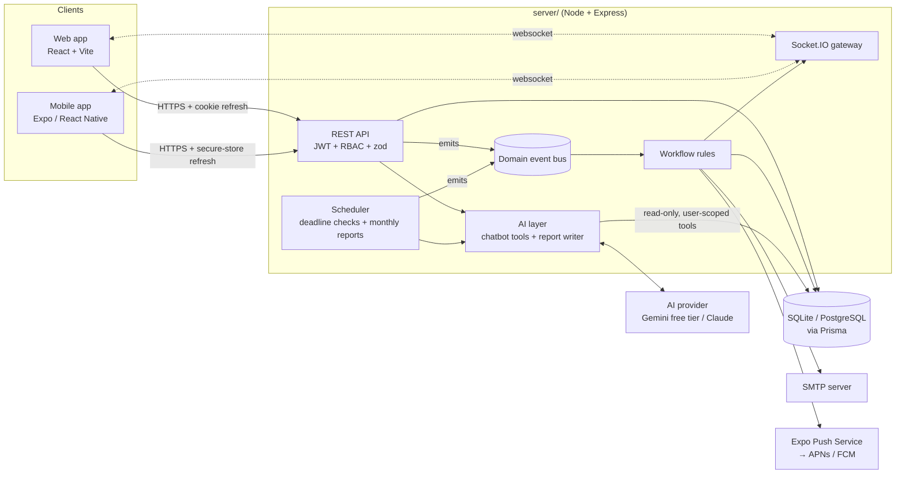

# Nesma Tasks: AI-powered team communication & task management

This is the submission for the technical assessment in [README.md](README.md). It has three parts:

| Part | Stack | Folder |
|---|---|---|
| **API, realtime and automation server** | Node 22, Express 5, TypeScript, Prisma (SQLite in dev, PostgreSQL in prod), Socket.IO, node-cron, Nodemailer, Expo push, AI via Google Gemini (free tier, default) or Anthropic Claude | [`server/`](server) |
| **Web app** | React 19, Vite, React Router, Socket.IO client | [`web/`](web) |
| **Mobile app** | Expo SDK 58 (React Native 0.88), Expo Router, expo-notifications, expo-secure-store | [`mobile/`](mobile) |

The web app and the mobile app use the same API and the same realtime channel. A task updated on a phone appears on every open web dashboard right away, and the reverse is also true.



## How each requirement is met

| # | Requirement | Implementation |
|---|---|---|
| 1 | **Authentication & access control** | Each user has their own credentials (bcrypt, cost 12). Access JWTs last 15 minutes. Refresh tokens are rotated on every use, and reusing one revokes all of that user's sessions. On the web the refresh token is an httpOnly SameSite=Strict cookie; on mobile it is stored in the iOS Keychain or Android Keystore. Two roles: **Team leader** (sees the whole team, creates, assigns and deletes tasks, manages users, sees reports and automation) and **Team member** (sees tasks assigned to or created by them, updates status, progress and comments). Every query goes through one row-level rule, `taskScope()`. |
| 2 | **Task management** | Create, assign, re-assign, set deadline and priority, track status (To do → In progress → In review → Done) and progress (0-100%), comments, and a full activity history. Overdue and completed tasks are flagged and filterable. The web app has list and drag-and-drop board views. |
| 3 | **Automated notifications & emails** | Domain events (assignment, update, status change, comment, due soon, overdue, report ready) go out as in-app notifications, realtime socket events, mobile push and HTML email. Deadline reminders and overdue alerts are scheduled and fire **exactly once per deadline**. Every email is recorded in an audit log ("Email outbox"). |
| 4 | **AI-powered reporting** | Monthly reports are built from **real task data**. Completion rate, on-time rate, cycle time, per-member performance, delays and achievements are computed in code (deterministic and unit-tested). The AI then writes the narrative and recommendations from those numbers. Reports generate automatically at 07:00 on the 1st of each month and on demand. Leaders are notified and emailed. |
| 5 | **AI chatbot** | An LLM (free Google Gemini by default; Claude supported) with six **read-only tools** that query the live database (search tasks, task details, team overview, period metrics, members, recent activity). Each tool runs with the signed-in user's permissions, so a member's assistant cannot see other members' tasks. Conversations are persisted. Available on web and mobile. |
| 6 | **Workflow automation** | A single event bus feeds a single rules module ([`server/src/services/workflow.ts`](server/src/services/workflow.ts)) that connects assignment, progress updates, reminders, notifications and reporting. See [docs/WORKFLOW.md](docs/WORKFLOW.md). |
| 7 | **Mobile app** | Native app with a dashboard, task list with filters, task detail (status, progress, comments), task creation, team chat with typing indicators, the AI assistant, a notification inbox, push notifications that open the related task when tapped, and live sync over websockets. Supports dark mode and pull-to-refresh. |

## Quick start (local demo)

Requirements: Node 22+ and npm. No database server or Docker is needed.

```bash
npm run setup                 # installs all three apps, creates server/.env (random JWT secret),
                              # creates the SQLite DB and seeds demo data
# add your free Gemini key to AI_API_KEY in server/.env (see docs/SETUP.md)
npm run dev:server            # API on http://localhost:4000
npm run dev:web               # web on http://localhost:5173
npm run dev:mobile            # Expo dev server; scan the QR code
```

Demo accounts (password `Nesma@2026`):

| Email | Role |
|---|---|
| `leader@nesma.dev` | Team leader (Mona Hassan) |
| `sara@nesma.dev`, `omar@nesma.dev`, `youssef@nesma.dev`, `laila@nesma.dev` | Team members |

**Live demo:** https://basem1166.github.io/nesma-demo/ (online while `npm run demo:public` is running on the author's PC; it forwards to a free Cloudflare tunnel, no hosting account or card needed). See [docs/DEPLOYMENT.md](docs/DEPLOYMENT.md).

The seed has about 60 tasks spread over the last three months, with realistic histories: on-time and late completions, overdue work, comments and chat. The reports and the assistant therefore have real data to analyse.

## Documentation

| Document | Contents |
|---|---|
| [docs/SETUP.md](docs/SETUP.md) | Step-by-step local setup for the server, web and mobile apps (Expo Go vs development build, push setup) |
| [docs/DEPLOYMENT.md](docs/DEPLOYMENT.md) | Production deployment: PostgreSQL, HTTPS, reverse proxy with websockets, EAS builds for the store apps |
| [docs/SECURITY.md](docs/SECURITY.md) | **Secure configuration of credentials, email (SMTP) and AI API keys**, plus the security controls in the code |
| [docs/WORKFLOW.md](docs/WORKFLOW.md) | **Workflow diagrams** and the full automation rule table |
| [docs/DATABASE.md](docs/DATABASE.md) | **Database structure** (ER diagram, tables, migrations) |
| [docs/API.md](docs/API.md) | REST endpoints and realtime events |
| [docs/TESTING.md](docs/TESTING.md) | **Testing evidence**: automated test results and a scripted live demonstration |

## Repository layout

```
server/   Express API, Prisma schema + migrations + seed, automation, AI, tests
web/      React web app
mobile/   Expo app (src/app = screens via Expo Router, src/lib = API/session/push)
docs/     Setup, deployment, security, workflow, database, API and testing docs
```
