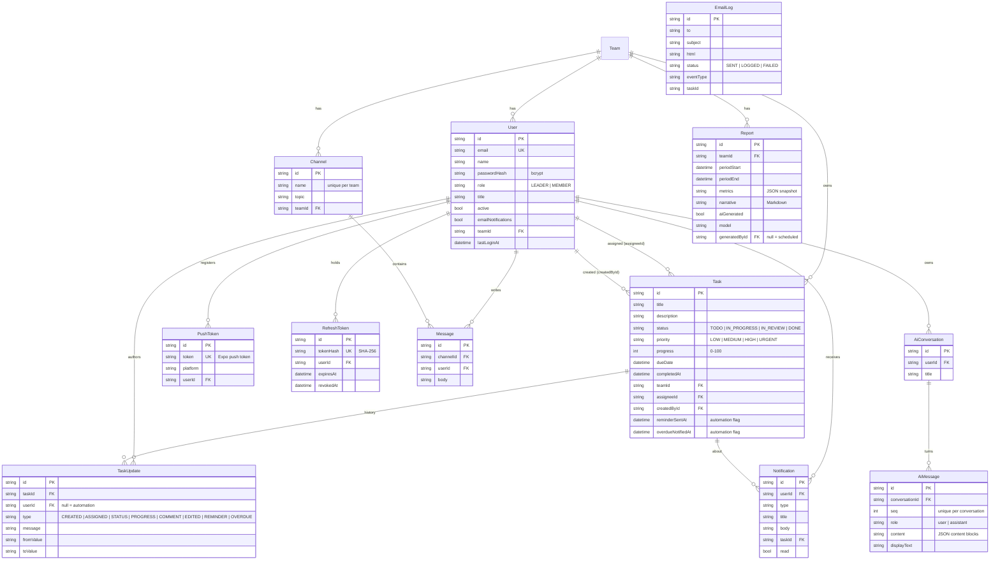

# Database structure

The source of truth is [`server/prisma/schema.prisma`](../server/prisma/schema.prisma). Migrations are in [`server/prisma/migrations/`](../server/prisma/migrations). The initial migration's SQL is in `20261102160331_init/migration.sql`.

- **Development:** SQLite file (`server/prisma/dev.db`), so no database server is needed.
- **Production:** PostgreSQL. Change `provider = "sqlite"` to `"postgresql"` in the schema and run `npx prisma migrate dev --name init` once against an empty PostgreSQL database to produce a PostgreSQL migration (see [DEPLOYMENT.md](DEPLOYMENT.md)). Enum-like columns are stored as validated strings, so the schema is the same on both engines.

## Table notes

| Table | Purpose |
|---|---|
| `Team` | Tenant boundary. Every query is filtered by the caller's `teamId`. |
| `User` | Individual credentials and role. Deactivated users cannot sign in and receive nothing. |
| `RefreshToken` | Rotating refresh tokens (hash only), used to detect reuse and revoke sessions. |
| `Task` | The work item. `completedAt` is set and cleared automatically when the status changes. `reminderSentAt` and `overdueNotifiedAt` make reminders fire once per deadline. |
| `TaskUpdate` | Append-only activity log: who changed what, comments, and automation events. It feeds the activity timeline, the AI tools and the audit trail. |
| `Notification` | In-app inbox (web bell and mobile Inbox tab). |
| `PushToken` | Expo push tokens per device. Stale tokens are removed when Expo reports `DeviceNotRegistered`. |
| `EmailLog` | Every email attempt (sent, logged in dev, or failed with error). It is the Email outbox and the delivery audit. |
| `Channel`, `Message` | Team chat. |
| `Report` | Monthly report: the metrics JSON it was computed from, plus the narrative. |
| `AiConversation`, `AiMessage` | Assistant history, stored exactly as exchanged with Claude (including tool calls and results) so it can be replayed. |

## Indexes

Indexed for the hot paths: tasks by `(teamId, status)`, `assigneeId` and `dueDate` (scheduler scans), task history by `(taskId, createdAt)`, notifications by `(userId, read, createdAt)`, and messages by `(channelId, createdAt)`.
