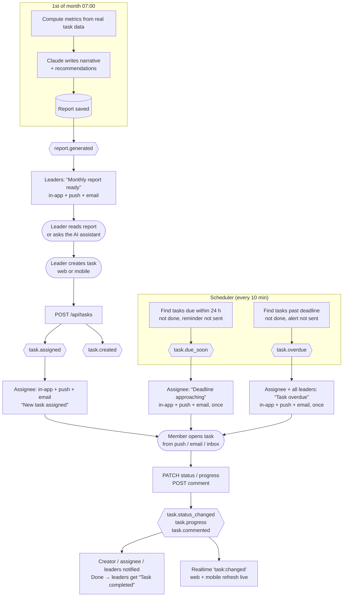
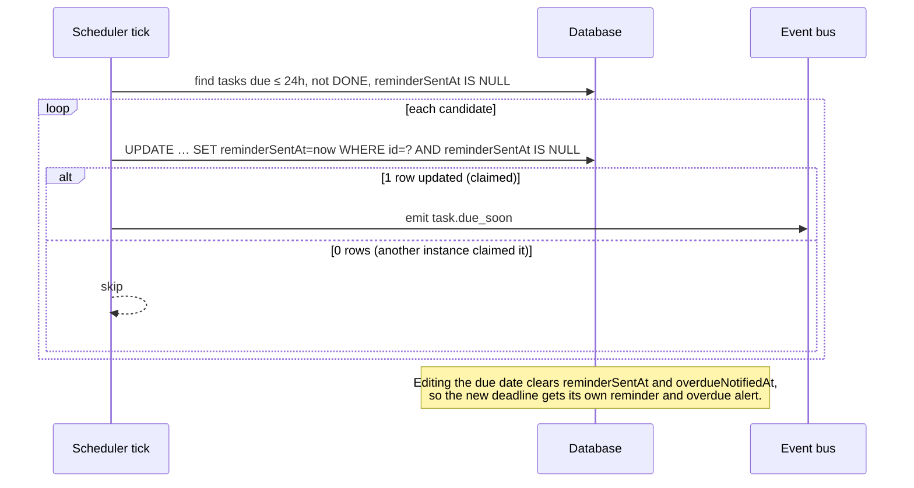
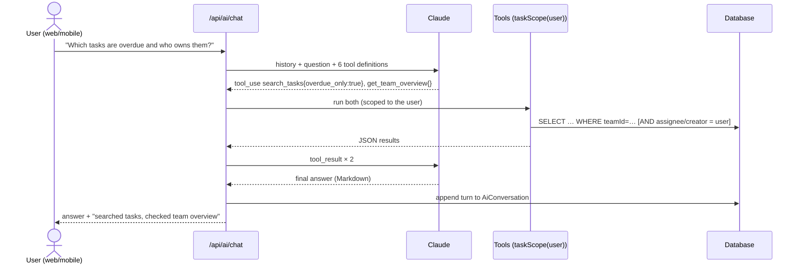

# Workflow automation

Task assignment, progress updates, reminders, notifications and reporting run as **one pipeline**:

1. **Producers** (REST routes, the scheduler) change data and *emit a domain event* on the bus ([`services/events.ts`](../server/src/services/events.ts)).
2. **Rules** ([`services/workflow.ts`](../server/src/services/workflow.ts)) decide who should know and what to tell them.
3. **Delivery** ([`services/notify.ts`](../server/src/services/notify.ts)) sends each message out on every channel: persisted in-app notification, realtime socket event, mobile push and email (if the user has email turned on).

A failing channel, such as SMTP being down, is logged and never blocks the others or the user's action.

## End-to-end workflow

## Event → recipients → channels

| Event | Trigger | Recipients (never the person who acted) | In-app | Push | Email |
|---|---|---|:-:|:-:|:-:|
| `task.created` | Task created | (live board refresh only) | | | |
| `task.assigned` | Created with assignee, or re-assigned | New assignee | ✅ | ✅ | ✅ |
| `task.updated` | Title, description, priority or due date edited | Assignee, creator | ✅ | ✅ | ✅ |
| `task.status_changed` | Status moved | Assignee, creator; **+ all leaders when Done** | ✅ | ✅ | ✅ |
| `task.progress` | Progress % changed (status unchanged) | Creator | ✅ | ✅ | – (too frequent) |
| `task.commented` | Comment posted | Assignee, creator | ✅ | ✅ | ✅ |
| `task.deleted` | Leader deleted task | Assignee | ✅ | ✅ | – |
| `task.due_soon` | Scheduler: due within `REMINDER_WINDOW_HOURS` (24) | Assignee | ✅ | ✅ | ✅ |
| `task.overdue` | Scheduler: deadline passed, not done | Assignee + all leaders | ✅ | ✅ | ✅ |
| `report.generated` | Monthly cron or manual "Generate" | All leaders | ✅ | ✅ | ✅ |
| Chat message | Message posted in a channel | Rest of the team | realtime | ✅ | – |

Every task event also sends `task:changed` to the assignee, the creator and the leaders over Socket.IO, so lists, boards, dashboards and detail screens refresh on web and mobile without polling.

## Exactly-once reminders

The scheduler also runs once at boot, so reminders missed while the server was down are sent on startup. Leaders can trigger a run on demand under **Automation → Run deadline checks now**.

## AI in the workflow

- **Monthly report.** `generateMonthlyReport()` computes the metrics in code: workload, completion rate, on-time rate, late completions, overdue at month end, average cycle time, per-member breakdown, delays and achievements, plus the previous month for comparison. Claude (`claude-opus-5-5`, effort `high`) is given that JSON and told to use only those numbers. The narrative and the metrics snapshot are stored together, so a report can always be traced back to its data.
- **Assistant.** For each question Claude decides which read-only tools to call (often several in parallel). The tools run against the database **with the asking user's permissions**, Claude answers from the results, and the full exchange is stored append-only so follow-up questions keep their context.

